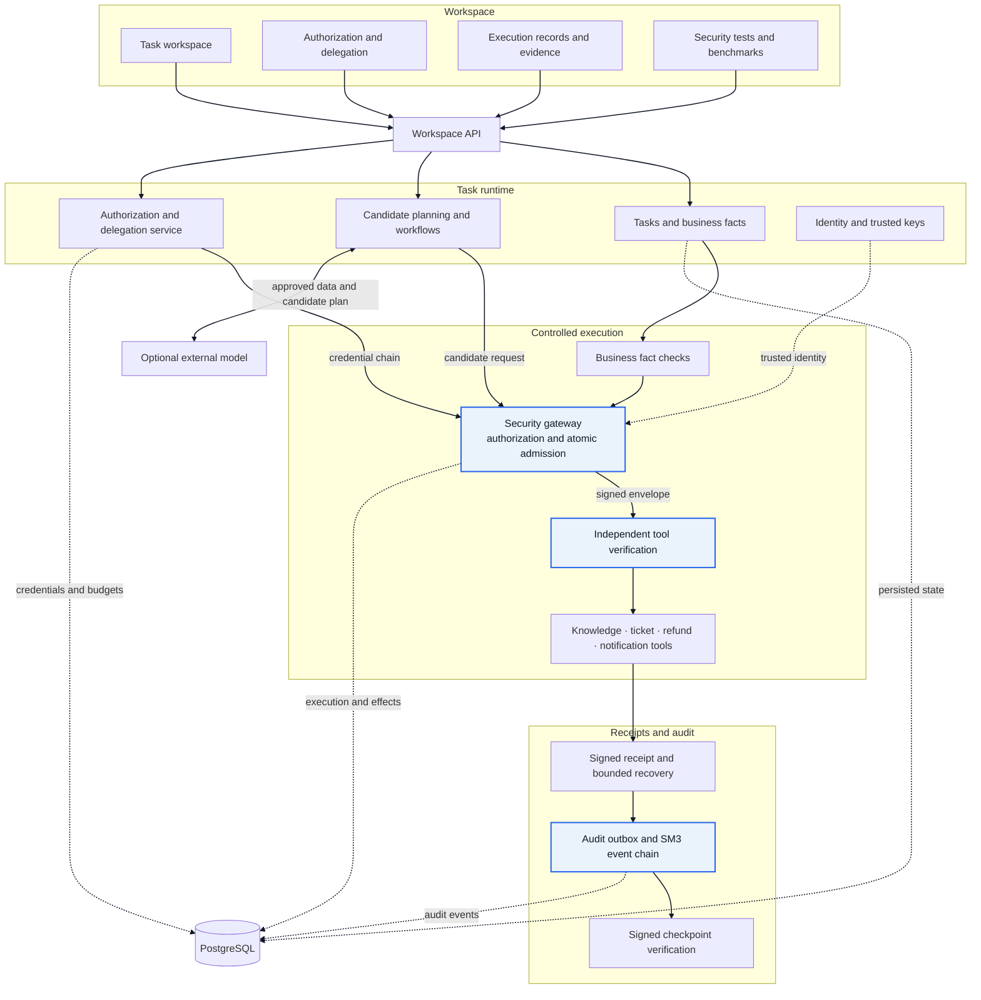
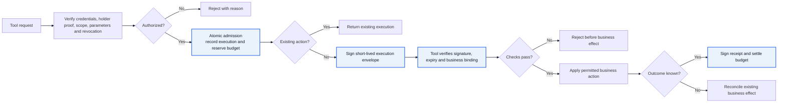

<div align="center">

# AgentGuard

**Authorization and execution control for agent tool calls**

[简体中文](README.md) · [Running guide](docs/RUNNING.en.md) · [Architecture](docs/ARCHITECTURE.md) · [Releases](https://github.com/bulashi/AgentGuard/releases)


</div>

AgentGuard separates candidate planning from authorization and tool execution. An operator defines a task scope and budget. The authorization service issues credentials, and the security gateway checks each request against the credential chain, caller, business facts, and shared budget. After admission, the gateway signs an execution envelope. The target tool verifies that envelope before applying the permitted action. Signed receipts and audit records link the request, authorization, and result for review.

Planning can use deterministic local rules or an optional configured external model. A model may suggest actions, but it cannot extend credential scope or bypass gateway checks. The included business tools write to local services and a local database, making the system suitable for evaluating authorization and controlled execution in an isolated environment.

## Contents

- [Features](#features)
- [Architecture](#architecture)
- [Quick start](#quick-start)
- [Run from source](#run-from-source)
- [Repository layout](#repository-layout)
- [Operational boundaries](#operational-boundaries)
- [Contributor and licensing](#contributor-and-licensing)

## Features

- **Task-scoped authorization and delegation:** Credentials bind a task to resources, tools, parameter constraints, budgets, expiry, and a holder. A delegated credential references its parent and is checked to ensure its scope is narrower.
- **Shared-budget admission:** Delegation branches consume their ancestor budgets together. In a database transaction, the gateway records a new execution, reserves budget, and binds idempotency data to avoid concurrent requests being approved against stale balances.
- **Two-sided execution checks:** The gateway validates a request and signs an execution envelope. The tool independently checks the gateway signature, parameter digest, expiry, and business binding before acting.
- **Result recovery and audit:** Signed receipts link requests, credential chains, and business results. Audit events enter an outbox and an SM3-linked event chain; signed checkpoints support independent verification. Uncertain outcomes enter reconciliation and bounded recovery.
- **Joint approval and revocation:** Enterprise and finance approvers can sign the same approval request. Revocation is checked again before new admission and dispatch.
- **Local or cloud planning:** Deterministic rules need no model setup. Cloud mode requires the ticket to be eligible for sharing and explicit operator confirmation before approved data is sent.

## Architecture

The diagram shows the main modules and data flows from the workspace and task runtime through the gateway, tools, receipts, and audit records.



An incoming tool call passes authorization checks, atomic admission, envelope signing, and independent tool verification. Repeated business actions return the existing execution state. An uncertain result is reconciled before further recovery.



## Quick start

### Download the Windows package

1. Download `AgentGuard-Windows-x64.zip` from [GitHub Releases](https://github.com/bulashi/AgentGuard/releases).
2. Extract the archive and keep the full `AgentGuard` directory. A writable path with English characters is recommended, for example `F:\AgentGuard`.
3. Double-click `启动AgentGuard.cmd`. On first launch, follow the initialization prompt. The launcher opens the workspace when initialization finishes.
4. Deterministic planning needs no model configuration. To use a cloud model, double-click `配置智能体.cmd` and enter your own service URL, model name, and API key in the workspace.
5. Double-click `停止本机.cmd` when finished.

The package includes a Windows x64 Python runtime and the application files. PostgreSQL is downloaded on first initialization and checked against the SHA-256 value pinned in the project. Later launches reuse the downloaded database component.

See the [running guide](docs/RUNNING.en.md) for details. First launch creates a local database, keys, model configuration, and logs under `.native`. Do not commit or share this runtime state directory.

### Run from source

The source workflow requires Windows x64, Python 3.12, Node.js 20.19 or later or 22.12 or later, npm, and network access. `scripts/bootstrap.ps1` creates a Python virtual environment, installs locked dependencies, and builds the web UI. `scripts/native-up.ps1` initializes and starts local services. First launch downloads PostgreSQL and creates local state and keys.

From the repository root in PowerShell:

```powershell
.\scripts\bootstrap.ps1
.\scripts\native-up.ps1 -OpenBrowser
```

Stop local services with:

```powershell
.\scripts\native-down.ps1
```

These commands initialize local runtime state. For ordinary use, download the complete Windows package from GitHub Releases.

## Repository layout

```text
AgentGuard/
├── backend/              # Workspace, authorization, agents, gateway, tools and audit
├── frontend/             # React workspace and frontend tests
├── protocol/             # Schemas, canonicalization rules and test vectors
├── database/             # PostgreSQL migrations
├── attacks/              # Security scenarios and runtime data
├── scripts/              # Windows startup, configuration, build and verification tools
├── docs/                 # Running, architecture and third-party component notes
└── third_party_licenses/ # License texts for bundled Python and frontend dependencies
```

## Operational boundaries

- Refund and notification actions are recorded by local business services and the local database. The package does not connect to production payment or SMS systems.
- Deterministic and configured cloud planning use the same authorization and tool checks. Cloud mode requires ticket sharing eligibility and operator confirmation before sending data.
- If a dispatched result is unknown, the system checks for an existing business effect and follows its recovery state. Automatic resumption of an entire workflow after a process restart is outside the current implementation.
- This project does not declare a separate open-source license. Third-party components retain their respective licenses; see `third_party_licenses/` before use.

## Contributor and licensing

| Contributor | GitHub |
| --- | --- |
| Project author | [@bulashi](https://github.com/bulashi) |

Third-party components remain subject to their own licenses. This repository does not grant an additional open-source license for AgentGuard project code.
