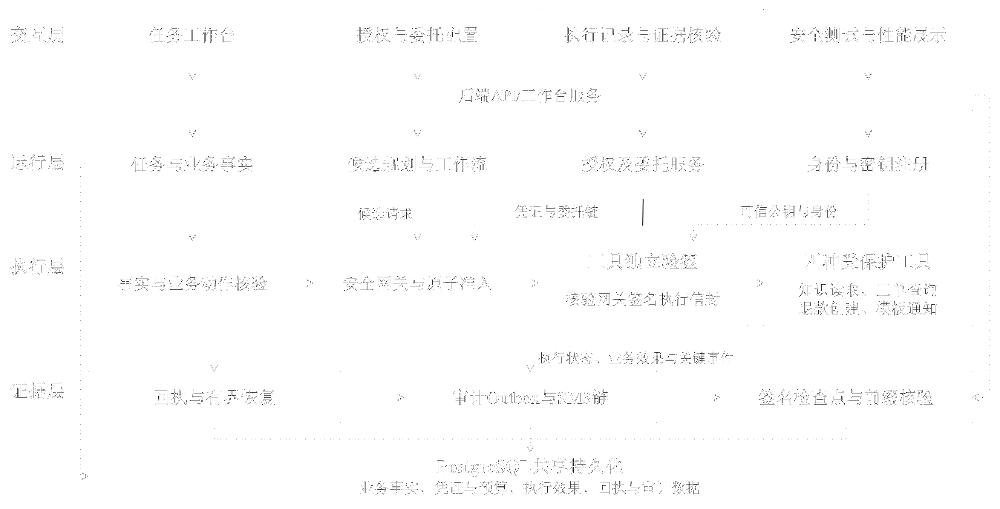
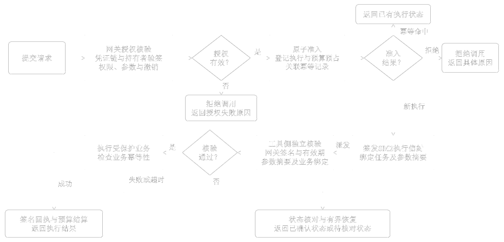
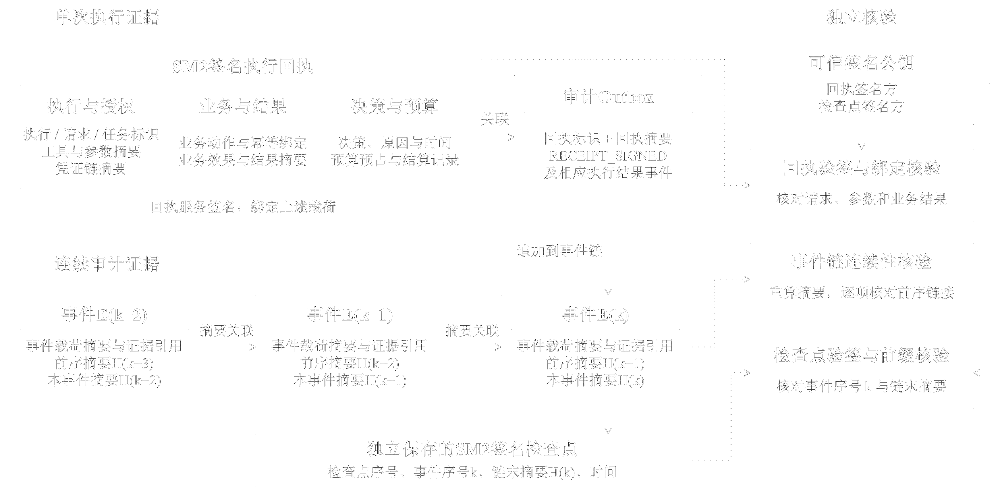
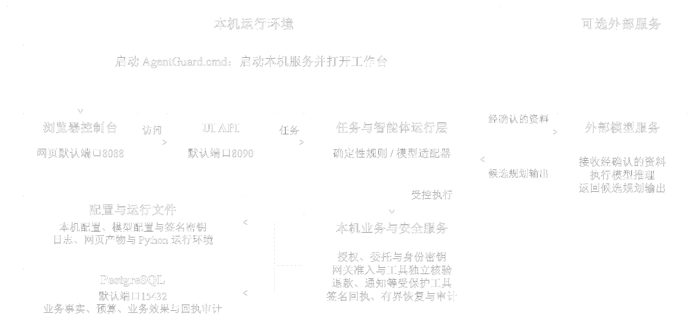

<div align="center">

# AgentGuard

**智能体业务工具调用的授权与执行控制系统**

[English](README.en.md) · [运行说明](docs/RUNNING.zh-CN.md) · [架构说明](docs/ARCHITECTURE.md) · [版本下载](https://github.com/bulashi/AgentGuard/releases)


</div>

AgentGuard把智能体提出的候选操作、权限核验和业务执行分开处理。操作者为任务设定范围与预算，授权服务签发凭证，安全网关在每次调用前检查凭证、调用者、业务事实及共享预算。网关准入后签发执行信封，工具服务再次核验信封，再处理获准的业务动作。回执与审计记录将请求、授权和结果关联起来，便于按任务查看和核对。

系统提供本机确定性规则规划，也可接入已配置的外部模型提供候选建议。模型只参与规划，不能自行扩大凭证权限或绕过网关。当前业务工具将结果写入本机服务和数据库，适合在隔离环境中评估授权与受控执行流程。

## 目录

- [功能概览](#功能概览)
- [架构](#架构)
- [开始使用](#开始使用)
- [从源码启动](#从源码启动)
- [项目结构](#项目结构)
- [运行边界](#运行边界)
- [贡献者与许可](#贡献者与许可)

## 功能概览

- **任务授权与委托**：授权凭证绑定任务、资源、工具、参数约束、预算、有效期及持有者；子委托引用父凭证并逐项检查权限是否收窄。
- **共享预算准入**：不同委托分支共同使用祖先预算。网关在数据库事务中登记新执行、预留预算并记录幂等关联，避免并发请求各自依据过期余额通过。
- **双重执行核验**：网关核验调用与授权后签发执行信封；工具服务独立验证网关签名、参数摘要、有效期和业务绑定，再处理对应操作。
- **结果恢复与审计**：签名回执关联请求、授权链与业务结果；审计事件写入Outbox并加入SM3关联事件链，检查点可供独立核验。结果不明时进入核对与有界恢复流程。
- **共同审批与撤销**：支持企业与财务两方共同签署审批请求；撤销状态在新的准入和派发阶段再次检查。
- **本机与云端规划**：确定性规则无需配置模型；云端模式只在工单允许共享且操作者明确确认后发送获准资料。

## 架构

下图从工作台、任务运行、网关与工具执行到回执和审计展示系统的主要模块与数据关系。

<div align="center">



</div>

一次新的工具调用依次经过授权核验、原子准入、执行信封签发和工具侧复核。重复业务动作会返回已有执行状态；结果无法确认时，系统转入结果核对流程。

<div align="center">



</div>

执行回执及审计事件如何关联、事件摘要如何组成链，以及检查点如何用于独立核验，见下图。

<div align="center">



</div>

部署图展示了Windows本机服务与可选外部模型之间的边界。外部模型返回候选规划，本机仍负责授权决策和业务执行。

<div align="center">



</div>

## 开始使用

### 下载Windows运行包

1. 打开[GitHub Releases](https://github.com/bulashi/AgentGuard/releases)，下载`AgentGuard-Windows-x64.zip`。
2. 解压后保留完整的`AgentGuard`目录。建议放在具有读写权限的英文路径中，例如`F:\AgentGuard`。
3. 双击`启动AgentGuard.cmd`，首次启动时按提示完成初始化。初始化结束后，启动器会打开工作台。
4. 使用确定性规则时无需配置模型。需要使用云端模型时，双击`配置智能体.cmd`，在工作台填写自己的服务地址、模型名称和API Key。
5. 使用结束后双击`停止本机.cmd`。

运行包包含Windows x64 Python运行环境、程序文件及锁定版本的PostgreSQL安装包。首次初始化会校验并解压随包提供的数据库组件；安装包缺失时，启动器会联网下载，并按项目内锁定的SHA-256值校验。后续启动复用已初始化的组件。

详细操作见[运行说明](docs/RUNNING.zh-CN.md)。首次启动生成的数据库、密钥、模型配置和日志保存在程序目录的`.native`中，请不要将该运行状态目录提交或分享。

### 从源码启动

源码方式用于开发和检查代码，需要Windows x64、Python 3.12、Node.js 20.19以上或22.12以上、npm以及可用的网络连接。`scripts/bootstrap.ps1`创建Python虚拟环境、安装锁定依赖并构建网页；`scripts/native-up.ps1`初始化并启动本机服务。首次启动需下载PostgreSQL组件并生成本机数据与密钥。

在PowerShell中从仓库根目录执行：

```powershell
.\scripts\bootstrap.ps1
```

随后执行：

```powershell
.\scripts\native-up.ps1 -OpenBrowser
```

停止服务：

```powershell
.\scripts\native-down.ps1
```

源码启动步骤与初始化会写入本机运行目录。若仅需运行系统，建议使用GitHub Releases中的完整Windows运行包。

## 项目结构

```text
AgentGuard/
├── backend/              # 工作台、授权、智能体、网关、工具与审计服务
├── frontend/             # React工作台界面与前端测试
├── protocol/             # 协议结构、规范化规则与测试向量
├── database/             # PostgreSQL迁移文件
├── attacks/              # 安全测试场景及其运行数据
├── scripts/              # Windows启动、配置、构建和核验脚本
├── docs/                 # 运行、架构及第三方组件说明
└── third_party_licenses/ # 随前端与Python依赖分发的许可文本
```

## 运行边界

- 退款与通知由本机业务服务和数据库记录承载，不连接生产支付渠道或短信服务。
- 确定性规划和已配置的云端规划均受相同的授权与工具核验约束。云端模式须检查工单共享资格，并由操作者确认资料发送。
- 已派发而结果未知时，系统先查询业务效果并按恢复状态处理。进程重启后的完整工作流自动续接不在当前实现范围内。
- 项目未声明单独的开源许可证。Python和前端依赖的许可文本及补充说明保存在`third_party_licenses/`；使用前请分别核对相关许可。

## 贡献者与许可

| 贡献者 | GitHub |
| --- | --- |
| 项目作者 | [@bulashi](https://github.com/bulashi) |

第三方依赖仍按各自许可证分发。本仓库未另外授予AgentGuard项目代码的开源使用许可。
